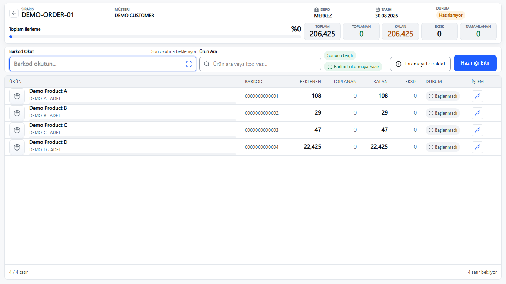

# OrderFlow

### Warehouse order preparation connected to an existing ERP

OrderFlow is a web application for preparing approved sales orders with barcode and manual quantity entry. It brings order progress, stock visibility, shortages, and operational feedback into a focused warehouse workflow while keeping Wolvox as the source of truth for sales orders and accounting.

**Stack:** React, TypeScript, Vite, ASP.NET Core (.NET 10), Firebird, SignalR, Playwright.

## The problem

Warehouse teams need to collect the right quantities against existing ERP orders, see what remains, and transfer the exact current preparation round into the native accounting workflow. A missed scan, duplicate request, or ambiguous order context can create costly discrepancies.

## What the application does

- Shows eligible ERP sales orders and the active preparation context.
- Provides a browser based keyboard barcode workflow and manual quantity correction.
- Tracks picked, remaining, missing, and deferred quantities for a preparation session.
- Shows general stock information and operational summaries where the source data supports them.
- Uses an interactive bridge to prepare exact current round quantities in the native Wolvox accounting screen. The operator reviews and saves the invoice in Wolvox.
- Includes focused recovery states for stale or mismatched native contexts.

## Architecture at a glance

```text
Browser (React/TypeScript)
          |
     ASP.NET Core API  ----  interactive Wolvox bridge
          |                         |
   Firebird / WOLVOX.FDB       native ERP screen
```

OrderFlow reads Wolvox business records and stores its own operational state separately in application owned tables within the existing Firebird database. Invoice creation and posting remain native Wolvox actions.

## Engineering challenges

- **ERP boundaries:** preserving the ERP's accounting ownership while providing a usable preparation workflow.
- **Operational consistency:** tracking claims and session state across scans, corrections, retries, and partial rounds.
- **Native context safety:** checking the active ERP order and exact quantities before handoff.
- **Desktop warehouse usability:** validating picking layouts, responsive behavior, and input interactions with automated browser tests.

## Preview



The image shows the actual OrderFlow web UI rendered with synthetic demonstration data. It is not a screenshot of a customer installation.

## Status

The application and installer have been built and tested. The latest Preparation UI correction has passed source tests, but its installation on the target server and final human visual acceptance remain pending. This showcase does not claim a completed production release.

## Confidentiality

This repository contains documentation and a sanitized demonstration screenshot only. It does not contain application source code, customer records, database schemas, credentials, or deployment packages. The application source is maintained privately.

---

**Berke Kırşallıoba** · Full-Stack .NET Developer  
[GitHub](https://github.com/berkekirsallioba) · [LinkedIn](https://www.linkedin.com/in/berkekirsallioba)
